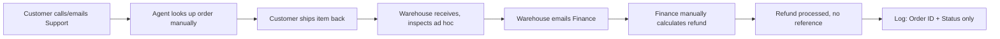
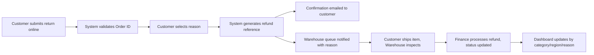

# AS-IS / TO-BE Process Map and Gap Analysis

## AS-IS: Current Manual Process

## TO-BE: Streamlined Self-Service Process

## Gap Analysis

| ID | Area | AS-IS | TO-BE | Addressed by |
| --- | --- | --- | --- | --- |
| GAP-01 | Return initiation | Phone/email only | Self-service web form | BR-01 / FR-01 |
| GAP-02 | Reason capture | Not recorded | Mandatory dropdown | BR-02 / FR-02, FR-03 |
| GAP-03 | Order validation | Manual lookup by agent | Automatic Order ID validation | FR-04 |
| GAP-04 | Refund reference | None, ad hoc | Auto-generated, unique | BR-03 / FR-05, FR-06 |
| GAP-05 | Warehouse notice | None; item arrives without context | Queue notification with reason, pre-arrival | BR-06 / FR-10 |
| GAP-06 | Reporting | None; return rate unknown | Power BI dashboard by category, region, reason | BR-04 / FR-07, FR-08 |
| GAP-07 | Status tracking | Single binary status ("Returned") | Multi-stage status (Submitted, Inspected, Refunded) | BR-07 / FR-11 |
| GAP-08 | Data retention | Minimal, no timestamp | Full record retained with request date | BR-05 / FR-09 |

Every gap traces back to a BR/FR pair already defined in the BRD and FRD.
